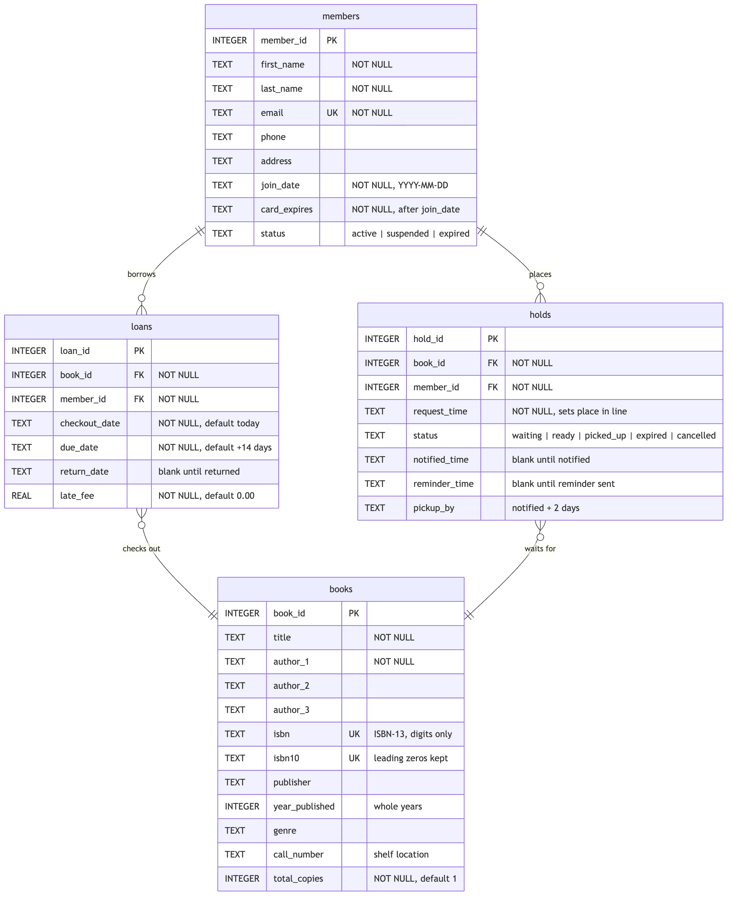
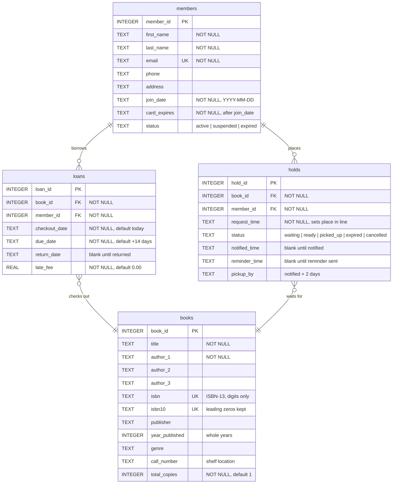

# Library Database Summary

The diagram source is in [erd.mmd](erd.mmd). It was drawn from the live schema of `library.db`.

## Tables

| Table | What it holds | Rows now |
|---|---|---|
| `books` | What the library owns, loaded from `books.csv` | 10,000 |
| `members` | Who can borrow (test members 207–215) | 9 |
| `loans` | Who has what, and when (8 still out) | 12 |
| `holds` | The waitlist (4 waiting, 2 ready, 1 expired) | 7 |

## Relationships

- A **member** can have many **loans** and many **holds**.
- A **book** can appear in many **loans** and many **holds**.
- `loans` and `holds` each link one member to one book through the `member_id` and `book_id` foreign keys.

## Views

| View | Purpose |
|---|---|
| `catalog` | What a person searching sees: availability, copies available, expected-back date, waitlist length |
| `book_authors` | Authors shown as "Author 1, Author 2, Author 3" |
| `waitlist` | Everyone waiting, with their place in line |
| `hold_notifications` | Holds ready for pickup, with the email address and whether the next-day reminder is due |

## Waitlist rules (triggers)

| Trigger | Rule it enforces |
|---|---|
| `holds_before_insert` | No duplicate place in line, no hold on a book you already have, only active members, only for books that are out |
| `loans_after_return` | When a copy comes back, the earliest waiting hold becomes `ready` with 2 days to pick up |
| `holds_after_release` | When a ready hold expires or is cancelled, the next person moves up |
| `loans_before_insert` | A copy held for someone can't be checked out by anyone else; only active members can borrow |
| `loans_after_insert` | Checking out the book closes that member's hold |

Missed pickups are expired by running [daily_holds_check.sql](daily_holds_check.sql) once a day.

## Dashboard

Forte Library has a two-tab web app built from this data:
https://claude.ai/artifact/8WaY49KGqmMam5hM3mhLvW

- **Catalog** (for patrons): search by title, author or ISBN, see whether a copy is available or when one is expected back, and join or leave a waitlist.
- **Owner** (for the library owner): headline numbers, overdue loans, the pickup shelf, a loan timeline, waitlists, member activity, and what the collection is made of.

The app reads a JSON export of `library.db`. To refresh it after the database changes, run `python3 dashboard/export_data.py`. To view it locally, run `python3 -m http.server 8765 --directory dashboard` and open http://localhost:8765.

## Files

| File | Purpose |
|---|---|
| [books.csv](books.csv) | The original book list (Goodreads, 10,000 titles) |
| [library.db](library.db) | The SQLite database |
| [schema.sql](schema.sql) | Tables, checks, views and triggers |
| [build_library.py](build_library.py) | Cleans `books.csv` and builds `library.db` |
| [seed_test_data.sql](seed_test_data.sql) | Test members, loans and holds for books 1–10 |
| [daily_holds_check.sql](daily_holds_check.sql) | Daily expiry of missed pickups and reminder list |
| [erd.png](erd.png) / [erd.mmd](erd.mmd) | The entity relationship diagram and its Mermaid source |
| [dashboard/index.html](dashboard/index.html) | The Forte Library app |
| [dashboard/library-data.json](dashboard/library-data.json) | Data exported from `library.db` for the app |
| [dashboard/export_data.py](dashboard/export_data.py) | Exports `library.db` to that JSON file |
